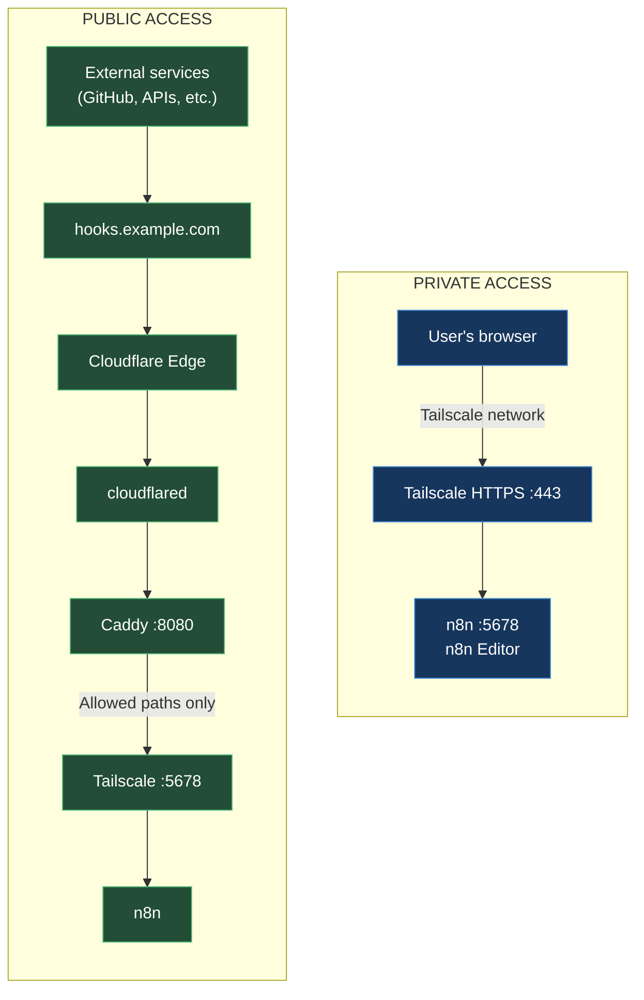

# n8n Self-Hosted Deployment

A self-hosted n8n deployment using Docker Compose, Tailscale, Cloudflare Tunnel, and Caddy.

This setup provides:

- Private HTTPS access to the n8n editor through Tailscale.
- Public access to selected n8n webhook endpoints through Cloudflare Tunnel.
- A reverse proxy that restricts public requests to webhook-related paths.
- Persistent storage for n8n workflows, credentials, and Tailscale state.
- No publicly exposed Docker ports and no router port forwarding.

NOTE:
This is a very long readme. It includes my 
- Architectural decisions (why use certain services)
- Config related help
Yes it's too long. I'll shorten it in future commits

## 1. Architecture

The deployment consists of four containers:

| Service | Purpose |
|---|---|
| `n8n` | Workflow automation engine |
| `tailscale` | Private network connectivity and HTTPS access to the n8n editor |
| `caddy` | Reverse proxy that permits only selected webhook paths |
| `cloudflared` | Establishes an outbound tunnel to Cloudflare |

### Network architecture



The n8n container shares the network namespace of the Tailscale container. This allows n8n to use the Tailscale network interface without requiring its own independent network connection.

Caddy and Cloudflared communicate over a dedicated Docker bridge network.

### Request routing

The public webhook hostname is:

```text
https://hooks.example.com
```

Caddy only permits these paths:

| Path | Purpose |
|---|---|
| `/webhook` | Production webhook endpoint |
| `/webhook/*` | Production webhook endpoints |
| `/webhook-test` | Test webhook endpoint |
| `/webhook-test/*` | Test webhook endpoints |
| `/webhook-waiting` | Waiting webhook endpoint |
| `/webhook-waiting/*` | Waiting webhook endpoints |

All other paths return HTTP 404.

This prevents the public Cloudflare hostname from becoming an unrestricted entry point to the n8n editor.

## 2. Repository structure

The expected repository structure is:

```text
n8n/
├── compose.yaml
├── .env
├── .env.example
├── .gitignore
│
├── caddy/
│   └── Caddyfile
│
├── tailscale/
│   └── serve.json
│
└── local-files/
```

The `.env` file contains machine-specific configuration and secrets. It must not be committed to Git.

The `.env.example` file provides a template for configuring another deployment.

The `local-files/` directory is mounted inside the n8n container at `/files`.

## 3. Prerequisites

Before deploying, ensure that you have:

- Docker Engine installed.
- Docker Compose v2 available.
- A Tailscale account.
- Tailscale MagicDNS enabled.
- Tailscale HTTPS certificates enabled.
- A domain managed through Cloudflare.
- A Cloudflare Tunnel created for the deployment.

No ports need to be opened on your router or published on the Docker host.

## 4. Configuration

### 4.1 Clone the repository

```bash
git clone <repository-url>
cd n8n
```

Create the required local directories:

```bash
mkdir -p caddy tailscale local-files
```

Create your environment file:

```bash
cp .env.example .env
```

Edit it:

```bash
nano .env
```

### 4.2 Environment variables

The deployment uses the following environment variables.

| Variable | Description |
|---|---|
| `TAILSCALE_HOSTNAME` | Tailscale machine hostname |
| `TAILSCALE_AUTH_KEY` | Tailscale authentication key used during initial registration |
| `CLOUDFLARE_TUNNEL_TOKEN` | Token for the Cloudflare Tunnel |
| `N8N_DOMAIN` | Full Tailscale MagicDNS hostname |
| `WEBHOOK_DOMAIN` | Public webhook hostname |
| `N8N_ENCRYPTION_KEY` | Encryption key used by n8n to protect stored credentials |
| `GENERIC_TIMEZONE` | Timezone used by n8n |

Example:

```dotenv
# Tailscale
TAILSCALE_HOSTNAME=n8n
TAILSCALE_AUTH_KEY=

# Cloudflare
CLOUDFLARE_TUNNEL_TOKEN=

# Hostnames
N8N_DOMAIN=n8n.example-tailnet.ts.net
WEBHOOK_DOMAIN=hooks.example.com

# Security
N8N_ENCRYPTION_KEY=

# Timezone
GENERIC_TIMEZONE=Asia/Kolkata
```

Replace the example Tailscale hostname with the actual MagicDNS hostname assigned to your machine.

#### Generate the n8n encryption key

For a new installation:

```bash
openssl rand -hex 32
```

Copy the output into `N8N_ENCRYPTION_KEY`.

**Important:** The encryption key must remain unchanged for the lifetime of an existing installation. n8n uses it to encrypt credentials stored in its database.

Losing this key can make previously stored credentials inaccessible.

Keep a secure backup of this key. Never commit it to Git.

For an existing installation, retrieve and preserve the original key rather than generating a replacement.

## 5. Tailscale configuration

Tailscale provides private network access to the n8n editor.

### 5.1 Enable MagicDNS and HTTPS

In the Tailscale administration console:

1. Enable MagicDNS.
2. Enable HTTPS certificates for your tailnet.
3. Ensure the machine is authorized to join your tailnet.

The resulting machine hostname should resemble:

```text
n8n.example-tailnet.ts.net
```

This hostname is used as `N8N_DOMAIN`.

### 5.2 Generate an authentication key

In the Tailscale administration console, navigate to the authentication keys section.

Generate an authentication key and place it in:

```dotenv
TAILSCALE_AUTH_KEY=
```

The key is used by the container to register the machine.

The persistent `ts_state` Docker volume stores the Tailscale state. This means the container can retain its machine identity across restarts without registering a new machine each time.

`TS_AUTH_ONCE=true` prevents unnecessary repeated authentication attempts.

Protect the authentication key and persistent Tailscale state.

### 5.3 Tailscale Serve configuration

The file `tailscale/serve.json` configures Tailscale Serve:

```json
{
  "TCP": {
    "443": {
      "HTTPS": true
    }
  },
  "Web": {
    "${TS_CERT_DOMAIN}:443": {
      "Handlers": {
        "/": {
          "Proxy": "http://127.0.0.1:5678"
        }
      }
    }
  },
  "AllowFunnel": {
    "${TS_CERT_DOMAIN}:443": false
  }
}
```

This configuration:

- Enables HTTPS on port 443.
- Proxies incoming requests to n8n on port 5678.
- Uses the Tailscale certificate domain.
- Explicitly disables Funnel.

The proxy target is `127.0.0.1:5678` because n8n shares the Tailscale container's network namespace.

The configuration is mounted into the Tailscale container through:

```yaml
volumes:
  - ./tailscale:/config:ro
```

And loaded using:

```yaml
TS_SERVE_CONFIG: /config/serve.json
```

This makes the Serve configuration persistent and automatically applied when the Tailscale container starts.

### 5.4 Accessing n8n

Once the deployment is running, connect your client device to the same Tailscale network.

Open:

```text
https://<N8N_DOMAIN>
```

For example:

```text
https://n8n.example-tailnet.ts.net
```

The editor is not exposed through the public Cloudflare hostname.

## 6. Cloudflare Tunnel configuration

Cloudflare Tunnel provides public access to the webhook endpoints without exposing the host's IP address or opening inbound ports.

### 6.1 Create a tunnel

In the Cloudflare dashboard:

1. Open Zero Trust.
2. Navigate to Networks and then Connectors or Tunnels.
3. Create a new Cloudflare Tunnel.
4. Give it a name, such as `n8n-webhooks`.
5. Select the Docker connector instructions.
6. Copy the tunnel token.

Add the token to `.env`:

```dotenv
CLOUDFLARE_TUNNEL_TOKEN=
```

The Cloudflared container uses this token to authenticate and establish an outbound connection to Cloudflare.

### 6.2 Configure the public hostname

In the tunnel configuration, add a public hostname:

| Setting | Value |
|---|---|
| Subdomain | `hooks` |
| Domain | Your Cloudflare-managed domain |
| Type | HTTP |
| Service | `http://caddy:8080` |

The resulting hostname is:

```text
https://hooks.example.com
```

**Important:** The service must point to `http://caddy:8080`, not directly to `http://n8n:5678`.

Caddy is responsible for restricting the publicly accessible paths.

The `caddy` hostname is resolved through Docker's internal network DNS.

No Cloudflare Access application is required for this configuration because the webhook endpoints are intended to be publicly reachable. Individual webhook workflows should implement their own authentication or verification where appropriate.

## 7. Caddy configuration

The `caddy/Caddyfile` defines the public reverse-proxy rules.

```caddyfile
:8080 {
    @webhooks path \
        /webhook \
        /webhook/* \
        /webhook-test \
        /webhook-test/* \
        /webhook-waiting \
        /webhook-waiting/*

    handle @webhooks {
        reverse_proxy http://tailscale:5678
    }

    handle {
        respond "Not Found" 404
    }
}
```

Caddy listens on HTTP port 8080 inside the Docker network.

It forwards permitted webhook requests to:

```text
http://tailscale:5678
```

The `tailscale` service name resolves to the Tailscale container's network interface. Since n8n shares its network namespace, the request reaches n8n.

All requests that do not match the allowlist receive:

```http
HTTP/1.1 404 Not Found
```

This configuration deliberately avoids exposing:

- The n8n editor.
- General application routes.
- Other n8n APIs.
- Unrelated application endpoints.

If additional n8n features need public callbacks, such as Forms or other webhook-like functionality, their paths must be explicitly evaluated and added to the allowlist. Do not broadly expose all n8n routes.

## 8. Starting the deployment

After configuring `.env`, Tailscale, and Cloudflare, validate the Compose configuration:

```bash
docker compose config -q
```

Start all services:

```bash
docker compose up -d
```

Check the container status:

```bash
docker compose ps
```

Expected services:

```text
tailscale
n8n
caddy
cloudflared
```

View logs:

```bash
docker compose logs -f
```

Individual service logs can be inspected using:

```bash
docker compose logs -f n8n
docker compose logs -f tailscale
docker compose logs -f caddy
docker compose logs -f cloudflared
```

## 9. Verifying the deployment

### 9.1 Verify Tailscale Serve

Run:

```bash
docker compose exec tailscale tailscale serve status
```

Confirm that HTTPS on port 443 forwards to:

```text
http://127.0.0.1:5678
```

Open the MagicDNS URL in a browser connected to your tailnet.

### 9.2 Verify the n8n application

Check the health endpoint from inside the shared network namespace:

```bash
docker compose exec n8n node -e \
"fetch('http://127.0.0.1:5678/healthz').then(r => console.log(r.status)).catch(console.error)"
```

An HTTP 200 response indicates that n8n is responding.

### 9.3 Verify Caddy's public routing

Test the root path:

```bash
curl -i https://hooks.example.com/
```

Expected result:

```text
HTTP/2 404
Not Found
```

This is intentional.

Test an unregistered webhook path:

```bash
curl -i https://hooks.example.com/webhook/test
```

If n8n responds with a message similar to:

```text
The requested webhook GET test is not registered
```

the request has successfully passed through:

```text
Cloudflare
    -> Cloudflared
        -> Caddy
            -> Tailscale
                -> n8n
```

The response is expected because no workflow has registered that webhook yet.

## 10. Creating a webhook workflow

To create a publicly accessible workflow:

1. Open the n8n editor using its private Tailscale URL.
2. Create a new workflow.
3. Add a Webhook node.
4. Choose the required HTTP method.
5. Configure its path.
6. Configure authentication where appropriate.
7. Save and activate the workflow.

For example, a workflow with the path:

```text
github-push
```

will have the production URL:

```text
https://hooks.example.com/webhook/github-push
```

The test URL will use:

```text
/webhook-test/github-push
```

Use the production URL for external integrations once the workflow is activated.

### Webhook security

Public webhook endpoints are reachable from the internet. They should not be treated as trusted simply because they pass through Cloudflare.

Use suitable authentication and request verification.

For GitHub integrations, verify the webhook signature using GitHub's signing secret or use an authenticated integration mechanism.

Do not place secrets directly in workflow URLs or query parameters.

## 11. Design decisions

The deployment deliberately separates private application access from public automation ingress.

### Why Tailscale for the editor?

The n8n editor is an administrative interface. Making it publicly accessible would unnecessarily increase the attack surface.

Tailscale provides private connectivity between authorized devices without requiring router port forwarding.

### Why Cloudflare Tunnel for webhooks?

External services such as GitHub need to reach webhook endpoints from the public internet.

Cloudflare Tunnel allows these services to invoke workflows without exposing the Docker host directly.

The tunnel establishes outbound connectivity, so inbound router ports are unnecessary.

### Why Caddy?

Cloudflare Tunnel alone would forward requests to the configured origin, but it would not provide the path-level restrictions we wanted.

Caddy acts as a small reverse-proxy security boundary.

It forwards only explicitly permitted webhook paths and returns 404 for everything else.

### Why does n8n share the Tailscale network namespace?

Using:

```yaml
network_mode: service:tailscale
```

allows n8n to use the Tailscale container's network interface.

This avoids running a separate Tailscale daemon inside the n8n container.

It also lets Tailscale Serve forward directly to:

```text
127.0.0.1:5678
```

### Why PostgreSQL is not configured here

This deployment uses n8n's default SQLite database stored in its persistent data directory.

For a single-instance self-hosted deployment, SQLite is a reasonable starting point. PostgreSQL can be introduced later if the deployment's scale, backup strategy, or operational requirements justify it.

### Why named Docker volumes?

Two named volumes are used:

| Volume | Purpose |
|---|---|
| `n8n_data` | n8n database, workflows, credentials, and settings |
| `ts_state` | Persistent Tailscale machine state |

This keeps application state separate from the Git repository and container lifecycle.

Recreating containers does not require recreating the volumes.

## 12. Maintenance and operations

### Restart services

```bash
docker compose restart
```

Restart one service:

```bash
docker compose restart n8n
```

### Update container images

```bash
docker compose pull
docker compose up -d
```

Review image changes before updating a production deployment. Pin tested versions rather than relying indefinitely on `latest`.

### Stop the deployment

```bash
docker compose down
```

This removes the containers and Compose network but preserves named volumes.

**Do not run `docker compose down -v` unless you intentionally want to delete the persistent application and Tailscale data.**

### Backup

Back up the following:

- The `n8n_data` volume.
- The `ts_state` volume, if preserving the Tailscale machine identity is important.
- The `.env` file, stored securely.
- The repository configuration.

The n8n encryption key must be backed up alongside the n8n data.

For consistent backups, stop n8n or use an appropriate database backup procedure before copying its SQLite database and associated files.

## 13. Security considerations

- Never commit `.env` to Git.
- Never commit Tailscale authentication keys or Cloudflare Tunnel tokens.
- Never expose the n8n editor through the public Cloudflare hostname.
- Keep the Caddy webhook allowlist restrictive.
- Preserve the original n8n encryption key.
- Protect Docker volumes and backups.
- Authenticate public webhook endpoints appropriately.
- Pin container versions for reproducible deployments.
- Keep Docker and container images updated.
- Avoid publishing ports unless there is a specific operational requirement.

## 14. Current limitations and possible improvements

This configuration is intended for a single n8n instance.

Potential future improvements include:

- Automated n8n workflow and credential backups.
- PostgreSQL as an alternative database.
- Health checks for service readiness.
- Container image version pinning.
- Monitoring and alerting.
- Additional explicitly permitted webhook routes when required.
- Automated deployment through GitHub Actions.
- A documented recovery procedure for restoring n8n data and encryption keys.

---

## Summary

This deployment uses a split-access architecture:

| Component | Access model |
|---|---|
| n8n editor | Private, through Tailscale |
| n8n webhooks | Public, through Cloudflare Tunnel |
| Caddy | Internal Docker network only |
| n8n application port | Internal shared network namespace |
| Docker host | No published application ports |
| Router | No port forwarding |

The result is a self-hosted automation platform where administrative access remains private while external services can invoke explicitly permitted workflows.
